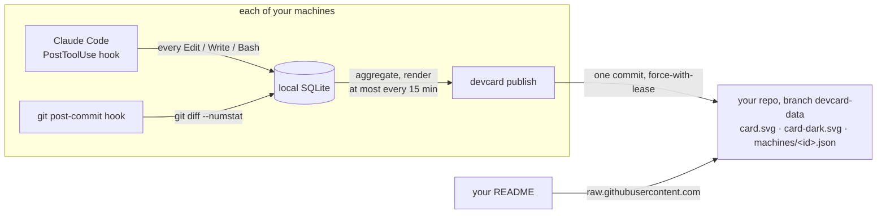

<h1 align="center">devcard</h1>

<p align="center">
  <strong>An embeddable dev stats card built from your real AI-assisted coding activity — rendered on your machine, published to your own repository.</strong>
</p>

<p align="center">
  <a href="https://github.com/augbastos/devcard/actions/workflows/ci.yml"></a>
  <a href="LICENSE"></a>
  
</p>

<!-- devcard:start -->
<picture><source media="(prefers-color-scheme: dark)" srcset="https://raw.githubusercontent.com/augbastos/devcard/devcard-data/card-dark.svg"></picture>
<!-- devcard:end -->

<p align="center"><em>↑ The maintainer's card, published by <code>devcard publish</code> to this repository's <code>devcard-data</code> branch.</em></p>
A serverless card is one image per theme, without the per-language hover.</em></p>

WakaTime and friends are built around time spent coding. devcard is built around
a different question: **what came out of the session**. A hook records the edits
your agent makes — or, for any other tool, each commit — and your machine turns
that into a card.

- **No server.** Your machine renders the card and commits it to a branch of a
  public repository you choose. No cloud account, no database, no token, no
  Node — one runtime, Python.
- **Content-private by architecture.** Code, file names, paths and project names
  never leave your machine; nothing devcard publishes has a field that could
  hold one. What is published is activity metadata — which languages, how many
  lines, events and bytes, lines per day — plus a repository count.
  [Exactly what →](docs/privacy-and-security.md)
- **Near-live, not live.** The card republishes at most every 15 minutes while
  you work, and GitHub's image caching adds a few minutes on top.
  [Why, and how it works →](docs/serverless.md)
- **Embeds anywhere** an image works, has a light and a dark file for GitHub's
  themes, and speaks en/pt/es.

## Get one

Python 3.11+, git, [pipx](https://pipx.pypa.io), and the
[GitHub CLI](https://cli.github.com) logged in (`gh auth login`). The repository
you publish to must exist and be public — your profile repository
(`<you>/<you>`) is the usual choice. devcard never creates one.

```bash
pipx install git+https://github.com/augbastos/devcard
devcard init
```

`init` checks the prerequisites, installs **one** capture hook, asks which
repository to publish to, publishes once, and prints the snippet for your
README:

```html
<picture>
  <source media="(prefers-color-scheme: dark)" srcset="https://raw.githubusercontent.com/<owner>/<repo>/devcard-data/card-dark.svg">
  /<repo>/devcard-data/card.svg">
</picture>
```

From then on the hooks publish by themselves. `devcard publish --force` publishes
now; `devcard render --out DIR` writes this machine's card locally without
publishing anything. On a second machine, run the same two commands with the
same repository — each machine publishes only its own numbers, and the card
adds them up ([details](docs/serverless.md#several-machines)).

## Works with your agent

Pick **one** capture mode per machine; running both would count the same lines
twice.

| | Mode | Granularity |
|---|---|---|
| **Claude Code** | `claude` | Per edit, through a Claude Code hook |
| **Anything that commits through git** | `git` | Per commit, real diff stats |

`git` mode hooks git itself rather than the agent, so anything that commits
through git is covered — Codex, Cursor, aider, Windsurf, a local model, your own
hands — with no per-tool integration to maintain. `devcard init --mode git
--git-folder <folder>` installs it in every repository in a folder.

## Make it yours

`~/.claude/devcard/config.json` holds the layout (`full`, `wide`, `banner`,
`half`, `vertical`), theme (`default`, `dark`, `light`, `gentle`, `cyberpunk`,
`terminal`), language (`en`, `pt`, `es`), an optional timezone, badges and pinned
repositories. `devcard init --layout wide --theme terminal --lang pt` sets them
too. [All of it →](docs/customizing.md)

`devcard serve` opens a loopback-only [local dashboard](docs/dashboard.md)
with daily token counts by agent/model family and API-equivalent cost estimates.
Publish and dashboard startup incrementally scan local Claude Code and Codex
transcripts; set `"usage": false` to skip scanning. The published machine JSON
includes agent totals and daily usage only when the matching card line is on;
by default they stay on this machine.
Unknown prices remain unavailable; estimates are not subscription bills.

Optional card lines use `"card": {"show_agents": true, "show_usage": true}`.
Both default to false. Agent percentages use recorded lines added when an
`agent` column exists. Active hours estimate sessions from event gaps (15-minute
idle threshold, 2-minute tail); concurrent agents are counted independently.

## How it works



Events land locally first, so capture works offline and never blocks your
session. Publishing reads every machine's file from the branch, replaces only
its own, renders the merged card and pushes one commit — or nothing, when
nothing changed.

## Built to be checked

- **The renderer is held to golden files.** The Python renderer must reproduce,
  byte for byte, 46 reference SVGs produced by the original TypeScript renderer
  from the same events — every layout, theme and language.
- **Tests run against the real thing**: real SQLite, real git — temporary bare
  repositories for publishing, throwaway repositories for the git hook (merges,
  worktrees, `core.hooksPath`, husky, paths with spaces).
- **CI** runs the Python suites on Linux and Windows at 3.11 and 3.14, installs
  the package with pipx, and runs the legacy Worker's suite. No account, no
  secret, no network in the tests.
- **Supply chain**: no runtime dependencies (`tzdata` on Windows only), every
  Action pinned to a commit SHA, Dependabot, dependency review, Gitleaks over the
  full history, and CodeQL.

## The legacy Worker

Before this, devcard was a Cloudflare Worker + D1 that the hooks synced to every
~20 seconds. It still works, it still serves the card above, and it stays in
`worker/` until that card is migrated; it is no longer the recommended install.
It needs Python 3.11+, Node 22+, npm, git and a Cloudflare account:
`git clone https://github.com/augbastos/devcard && cd devcard && python install.py`.
[Its setup](docs/manual-setup.md) · [its hover trick](docs/hover-in-a-readme.md) ·
[its retention notes](docs/retention.md) · [worker/README.md](worker/README.md)

## Going deeper

| | |
|---|---|
| [The serverless card](docs/serverless.md) | Publishing, freshness, where files live, several machines |
| [What the numbers mean](docs/counting.md) | Counting rules, merge commits, two machines |
| [Privacy and security](docs/privacy-and-security.md) | What leaves your machine, and what stops it |
| [Known limitations](docs/limitations.md) | Where it under- and over-counts, and why |
| [Making it yours](docs/customizing.md) | Themes, layouts, badges, pinned repos |
| [Development and CI](docs/development.md) | The suites, the golden files, the checks |

---

Built by [Augusto Bastos](https://github.com/augbastos) · MIT
